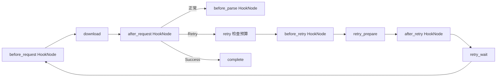

# 第十二章：Hook 节点与 signals

Air 的每个业务插槽都是独立 HookNode。一个节点按 index 顺序执行该阶段的所有注册函数，
普通函数返回 None 时继续下一项；抛出领域信号时立即退出函数，并停止当前插槽剩余回调。
Node 将信号转换成已声明的输出端口，Interlace 仍只处理普通 Graph、Output 与 Edge。

下图中的方框都是 Node，before/after 节点内部负责调用注册的 Hooks：



## 编写业务 Hook

```python
from bricks import hooks, signals
from bricks.spider.air import Spider


class MySpider(Spider):
    """通过显式信号决定响应后流程。"""

    @hooks.on(hooks.AFTER_REQUEST, index=0)
    def check_response(self, context):
        """处理限流和明确无效的响应。

        Args:
            context: 当前响应上下文。

        Raises:
            signals.Retry: 限流时等待一秒后重试。
            signals.Failure: 请求对应的数据不存在。
        """
        if context.response.status_code == 429:
            raise signals.Retry(delay=1)
        if context.response.status_code == 404:
            raise signals.Failure("页面不存在")
```

也可使用 `spider.use(form, {"func": callback, "kwargs": ..., "index": ...})`。
声明在打开时固定，同索引保持注册顺序，实例方法、静态方法、类方法和继承覆盖沿用相同规则。
match 必须同步返回 bool，普通 Hook 必须返回 None，不能返回节点名或 Output。

直接 use 的插件可以省略 Context 参数，并在函数内调用 `Context.get_context()`；显式接收 Context 的写法仍然支持。
当前绑定按同步调用链和异步任务隔离，在 await 前后保持一致，回调结束后不可读取。消费、初始化和生命周期插件应分别
使用 Context、InitContext 和 HookContext，类别错误会明确失败。函数同时兼容两种调用形式时优先显式传入 Context；
match 使用相同规则，但仍只接受同步布尔结果。

图内插槽支持同步与异步 Hook。异步回调抛出的信号在 await 边界使用同一规则处理；
同一插槽内严格串行等待。不要依赖回调所在的物理线程：异步链中的后续同步回调可能运行在异步运行器线程，
长时间同步 I/O 会阻塞该运行器，应使用原生异步回调或将同步业务安排在独立同步业务节点。

## 图内信号

| 信号 | 作用 | 允许位置 |
| --- | --- | --- |
| `Success()` | 跳到 complete，结束当前任务；完成后才确认交付 | 图内业务方法与 Hook |
| `Failure(reason)` | 报告失败，不确认成功，不再运行后续业务 | 图内业务方法与 Hook |
| `Retry(delay=None)` | 进入有界重试分支，保留当前 Slot | AFTER_MAKE_REQUEST、BEFORE_REQUEST、下载操作、AFTER_REQUEST |
| `Pass()` | 停止当前插槽剩余 Hook，走正常后继 | HookNode 内 |
| `Skip()` | 跳过 before 对应业务操作，仍经过 after 插槽 | 下表列出的 before 插槽 |

Signal 继承 BaseException，因此业务代码中的 `except Exception` 不会误吞流程控制。
普通异常、KeyboardInterrupt、取消、超时和引擎控制异常不会被当作重试；非法阶段的信号明确报错。
旧动态 Switch、任意修改 next、进程级全局 Context，以及 Context.success/failure/retry 与 action/stop 标志均不保留。
回调作用域内的 Context.get_context() 只是当前 Context 的便捷视图，不保存或改变图内状态所有权。

`Retry` 每经过一次 retry 节点就消耗一个预算，即使 Hook 在真正下载前要求重试，也不会无限循环。
`context.attempt` 是实际下载次数，`context.retries` 是已消耗重试次数。
`delay=None` 使用 Spider.retry_delay；显式 delay 是本次等待秒数。重试只重新下载及执行相关插槽，
不会重新运行 make_request、解析或存储；代理与会话不会自动更换。

| Skip 所在插槽 | 必须提供的替代数据 | 后继 |
| --- | --- | --- |
| BEFORE_MAKE_SEEDS | 无；使用空种子源 | AFTER_MAKE_SEEDS |
| BEFORE_PUT_SEEDS | 无；明确忽略当前批次 | AFTER_PUT_SEEDS，然后提交进度 |
| BEFORE_MAKE_REQUEST | `context.request` | AFTER_MAKE_REQUEST |
| BEFORE_REQUEST | `context.response`，如缓存响应 | AFTER_REQUEST |
| BEFORE_PARSE | `context.items` | AFTER_PARSE |
| BEFORE_PIPELINE | 无；跳过业务存储方法 | AFTER_PIPELINE |

普通业务完成应返回 None。`Success` 是提前结束，后续存储及后置插槽可能被跳过。
例如在 pipeline 中正常返回会执行 AFTER_PIPELINE 存储插件；在同一位置抛出 Success 则直接进入 complete。

默认 `After.bypass` 对 2xx 正常返回，-1/429/5xx 抛出 Retry，其余抛出 Failure。
显式 `ok(context)` 或可信字符串条件返回 True 时正常继续、False 时抛出 Retry。
`scripts.is_success` 条件成功时正常继续、失败时缺省抛出 Retry；分页的 `success=True` 会提前结束当前任务。
因此响应展示、计数等需要执行的插件应放在会中断插槽的校验之前。

## 实际插槽位置

| 范围 | 插槽 | 执行位置 |
| --- | --- | --- |
| 初始化 | BEFORE/AFTER_MAKE_SEEDS | 种子工厂前后 HookNode |
| 初始化 | BEFORE/AFTER_PUT_SEEDS | 当前批次提交前后 HookNode |
| 消费 | BEFORE/AFTER_MAKE_REQUEST | 请求构造前后 HookNode |
| 消费 | BEFORE/AFTER_REQUEST | 下载前后 HookNode |
| 重试 | BEFORE/AFTER_RETRY | 有界重试分支内，on_retry 前后 HookNode |
| 消费 | BEFORE/AFTER_PARSE | 解析前后 HookNode |
| 消费 | BEFORE/AFTER_PIPELINE | 存储前后 HookNode |
| 实例 | BEFORE_START | 首次打开完成装配前，以同步 HookContext 调用 |
| 实例 | BEFORE_CLOSE | 停止执行后、释放自有资源前，以同步 HookContext 调用 |
| 领取 | BEFORE_GET_SEEDS | 后端真正尝试 claim 前 |
| 交付 | AFTER_GET_SEEDS | 已领取且本地 Slot 已分配、消费图尚未运行时 |
| 错误 | ERROR_OCCURRED | 业务及插槽普通异常，以同步 HookContext 通知 |

生命周期和领取插槽不塞入已经开始的消费图，也不声称拥有不存在的 Graph execution。
它们的 `HookContext` 提供 target、form、task_queue、queue_name；领取后另有 lease、seeds 和 slot。
错误插槽提供原异常 error 和原上下文 source。回调不可自行确认或续租 lease，也不能恢复原异常。

非图插槽只接受同步回调，异步声明在启动时失败，运行中返回的 Awaitable 也明确拒绝。
领取前的普通 Hook 应快速返回；需要等待使用 `raise signals.Wait(seconds)`，
后端推迟下一次轮询并继续续租在途任务，不让 Hook 用 sleep 阻塞心跳。
存储或 Hook 抛出的 TimeoutError 会原样交给调用方，不会被当成短轮询超时吞掉。
外部关闭先停止新领取并排空本地交付，再等待运行入口退出，队列中留给其他实例的任务继续保留。

| 非图插槽 | 允许的 signals |
| --- | --- |
| BEFORE_START | Pass 继续启动；Success 跳过本实例初始化和消费；Failure 报告启动失败 |
| BEFORE_CLOSE | Pass/Success 停止剩余关闭 Hook，资源清理继续；Failure 报错但仍清理资源 |
| BEFORE_GET_SEEDS | Pass 放行；Skip 暂缓一轮；Wait 延迟领取 |
| AFTER_GET_SEEDS | Pass 进入图；Success/Failure 明确终结当前交付，后端校验租约后写回 |
| ERROR_OCCURRED | 只观察并正常返回；任何二次错误保留为原错误的原因链 |

初始化 AFTER_PUT_SEEDS 运行时任务已经被存储接受，不能撤销此前入队。
它正常完成后才保存恢复进度；若异常退出，下一次按旧进度重放并依靠稳定 Work ID 去重。
这两个投放插槽只覆盖初始化迭代批次，普通 context.submit 不冒充初始化阶段。

旧版 `AFTER_RETRY` 常量没有实际调用，新版已有独立节点。
`ON_*` 只用于当前阶段标记，不是自动触发的插槽。
旧 BEFORE_WORKER_START/CLOSE 对应物理线程，新资源模型由 Interlace 管理线程、由 Slot 管理逻辑资源；
Air 不提供这两个同名插槽，注册时明确失败。同步 SessionDownloader 由 Air 按 Slot 自动准备和关闭；
异步 Session 与调用方注入的其他 Slot 资源仍遵守显式所有权规则。

## 执行限制与验证

HookNode 也是 Node，每次触发计入 max_steps。原本按少数业务节点设置的步数预算需要按新图重新确定；
HookNode 的超时也属于自身节点边界，整个 Graph 的 timeout 仍覆盖完整执行。

```bash
uv run --locked pytest -q tests/crawler/test_air_signals.py tests/crawler/test_air.py
```

用例覆盖独立阶段节点、同步/异步信号、剩余 Hook 中断、Skip 后置插槽、下载前重试预算、
真实 HTTP 代理上的并发 Slot/Cookie 保持、领取前等待不阻塞续租、领取后显式终结、
初始化检查点顺序、启动/关闭和错误不可恢复。

[返回目录](README.md)
